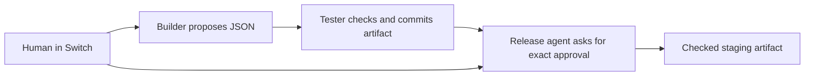

# ReleaseRoom

**Ask for a page change in your team’s Switch room. Review the actual artifact. Approve exactly what gets released.**

ReleaseRoom turns a small content request into a checked staging release through three Switch roles: builder, tester and release agent. The person stays in chat while a release desk shows the diff, Git commit, independent checks and artifact fingerprint. A later change invalidates the earlier approval.

Useful for community landing pages, launch teams and internal announcements where “approved” should mean a particular checked revision, rather than whichever file happens to exist when a bot publishes it.

## Problem and solution

A team approves one version in chat, then a later edit changes what the agent publishes. ReleaseRoom makes that mismatch observable and blocks it: builder, independent tester and release agent exchange work through Switch, while a human approves the full fingerprint of the reviewed revision. The live desk shows all six content fields, checks, revision history and downloadable evidence; it copies an approval command without sending it on the human's behalf.

## See the completed Switch workflow

Watch the [55-second narrated demo](https://releaseroom-switch.vercel.app/#demo), [download the MP4](https://releaseroom-switch.vercel.app/demo/releaseroom-demo.mp4), inspect the [live release evidence](web/demo/live-release-evidence.json), or open the [recorded approved page](https://releaseroom-switch.vercel.app/demo/approved-site.html). English captions are available in the player and [as a VTT file](web/demo/releaseroom-captions.vtt). The [CI workflow](https://github.com/NSEVEjk0/releaseroom-switch/actions/workflows/verify.yml) runs the backend, protocol and browser checks.

The demonstration was completed on 7 November 2026 using a real self-hosted Switch/Mattermost room, three separately authenticated agents, NEAR AI `z-ai/glm-5.3-flash`, and the user's genuine chat requests and approvals. A human changed “Join the build night” to “Join the community build night”; revision 3 passed all seven independent checks. The release agent rejected the old approval, accepted the actual person's current full-fingerprint command, and published staging HTML whose SHA256 matched the reviewed artifact.

Switch carries the authenticated request, builder-to-tester handoff, tester-to-release handoff and human decision in the same room. [The worker](releaseroom/worker.py) uses targeted messages and actual participant identities; [the current protocol adapter](releaseroom/protocol.py) preserves connection state and durable addressed messages. Without that room transport, this team workflow cannot receive its request or human approval. [The store](releaseroom/store.py) independently binds and rechecks the artifact before publication.

The public page opens without an account. Watch the completed workflow, try the release desk, and download its checked artifact and evidence.

## Try the release desk

Open the [release desk](https://releaseroom-switch.vercel.app/#desk). The interactive example lets you inspect the change, try an earlier approval, verify the evidence and open the approved page. Its fixed inputs run through the release engine; the completed Switch workflow is shown in the video above.

The actual reviewed artifact has its own Git repository: [download its bundle](web/demo/approved-artifact.bundle). Its commit `c799564b92ad06704a670cf6663d96c68bb19959` is the content artifact's commit, separate from this application's source commits. After cloning this application, inspect it with:

```sh
git clone web/demo/approved-artifact.bundle /tmp/releaseroom-recorded-artifact
git -C /tmp/releaseroom-recorded-artifact fsck --strict
git -C /tmp/releaseroom-recorded-artifact show c799564b92ad06704a670cf6663d96c68bb19959:index.html | sha256sum
```

Expected HTML SHA256: `f7e39ce85cfc20820fd5b9b4f361a6afa70de820dc82bdda29ce5261909393a4`. Public evidence contains observed controller records with opaque participant identities withheld; it is not an independent signature or host attestation.

For a new model-free engine reference:

```sh
python3 -m unittest tests.test_core tests.test_protocol tests.test_setup -v
RELEASEROOM_DEMO_DIR=/tmp/releaseroom-example python3 -m releaseroom.cli demo reports/reference-release.json
python3 -m releaseroom.cli verify reports/reference-release.json
git --git-dir=/tmp/releaseroom-example/artifact.git fsck --strict
```

Use an empty demo directory for a new reference. Expected output includes `"verified": true` and `"environment": "scripted-local-reference-no-Switch-no-AI"`. The earlier release is superseded; its approved fingerprint cannot publish the changed content. Verification checks reference integrity; it does not establish that an external person approved it.

## What approval binds

One full SHA256 fingerprint binds the release ID, current revision, reproducible Git commit, artifact, JSON source, checker implementation/policy, test evidence and original request. The publisher rechecks all bindings, current room health, human reviewer permission and the 15-minute expiry immediately before publishing. It verifies the pinned Git objects as well as the rendered HTML.

The builder proposes only six bounded JSON fields. The tester owns the schema, text limits, literal colors, WCAG 4.5 contrast check and three permitted local CTA destinations. Content is escaped into a fixed static renderer. Model text is never a shell command, deployment destination or approval.



Only the builder uses a model. Tester and publisher are deterministic agents with separate authenticated Switch identities. They share this controlled deployment process; they are not a hardware security boundary against the machine’s administrator.

## Connect an actual Switch room

Use Python 3.12+ and install `pip install -r requirements.txt`. The integration follows the current [Switch WebSocket + HTTP protocol](https://docs.switchagents.ai/switch-rooms/internals/agent-protocol), inspected at source revision `59d1f569ffb84f5fc66e2b6aa6a177619550f1a6`.

1. Register three agents once through your Switch administrator and add them to the same room as the human. Preserve their returned keys. Enable addressing between the configured owner’s agents and ensure human requests are addressed to the builder and approvals to the release role.
2. Create a protected JSON file with exactly `builder`, `tester`, `release` keys. Each profile has `id` (server agent ID), `api_key`, `name` (exact room agent name), and `participant_id` (opaque room identity).
3. Obtain the actual `list_participants` response after connecting to the room. `python3 -m releaseroom.cli resolve-profiles participants.json` resolves agent names to exact opaque IDs and lists human candidates. Choose the human’s returned `type: user` ID for `RELEASEROOM_REVIEWERS` and requesters. Do not derive IDs from display names, handles or Matrix strings. Switch can deliver a transport sender ID that differs from the participant ID. In that case, set `RELEASEROOM_IDENTITY_FILE` to a private server export containing one `{participant_id, sender_id, type}` record for each configured agent and person. The worker validates the complete map, rejects collisions and matches the canonical participant; names and chat text never grant permission. The VPS launcher reads these actual relationships from Switch’s participant/client database records.
4. Set the variables in `.env.example` in the service environment. Store the selected model key and team access code in private files. The builder supports NEAR AI (`z-ai/glm-5.3-flash`) and Vultr (`glm-5.3-flash`), with eight calls/day, 1,200 output tokens/call and one attempt per request. Request content leaves the controller for that configured provider when the builder runs.
5. Run `python3 -m releaseroom.cli doctor`, then run `python3 -m releaseroom.cli serve` and `python3 -m releaseroom.cli run` as supervised processes. Serve the controller behind HTTPS and keep its state directory persistent. Set `RELEASEROOM_ORIGIN` to that exact public address.

In chat, address the builder with:

```text
[releaseroom] request Make the invitation say Join the build night.
```

The tester and release agent exchange authenticated targeted handoffs. The release role posts the exact `approve <release-id> <full-fingerprint>` instruction to the review thread. A configured human sends that instruction to the release agent. Mobile pastes may omit spaces between `approve`, the complete 32-character release ID and the 64-character fingerprint; the worker parses those fixed widths without changing authority or release checks. Truncated or ambiguous commands receive feedback. The resulting page is available at `/staging`, with an artifact-hash response header. The desk is read-only; its access code cannot grant release authority. The model request uses JSON response mode and minimal GLM reasoning within the existing output limit. Empty or invalid proposals fail visibly without an automatic paid retry. An echoed context envelope is accepted only with an unchanged checker policy; its six content fields still go through all independent checks. Accepted provider responses leave hashes and bounded accounting metadata in the private event log, including the raw proposal hash when an envelope was normalized.

## Prepare a bounded VPS deployment

The launcher uses the pinned Switch 0.31.0 deployment contract, bundled Mattermost, persistent Docker volumes and separate supervised desk/worker processes. An optional sibling Shortlist workspace shares PostgreSQL through its own role and database. It keeps credentials in `.local/vps/` with private file permissions and preserves them across reruns.

From this repository, prepare with a private file containing `NEAR_AI_API_KEY` and optionally `NEAR_AI_MODEL`:

```sh
python3 -m releaseroom.vps prepare --model-env /path/to/private-model.env
python3 -m releaseroom.vps preflight
python3 -m releaseroom.vps start
```

Add `--shortlist ../shortlist` only when intentionally preparing that optional sibling. For a standalone Vultr model key file, use `--model-key /path/to/private-key.txt --provider vultr` instead of `--model-env`.

Run `start` from the ordinary VPS root terminal with Docker Compose and systemd available. The launcher checks model access without generation, inspects image sizes before pulling, reserves 8 GiB of free disk plus a dependency allowance, requires 1 GiB of available RAM and applies container/process memory and log limits. It runs backend checks and, when selected, Shortlist's isolated database, build and browser checks before enabling application services. Failed checks stop launch. These launch checks are followed by observing the actual human/agent workflow on that host; the linked November 7 recording documents the completed operator deployment.

All services bind to loopback. Forward ports `13000` (Switch Gateway), `18000` (Switch API), `18065` (Mattermost), `18090` (ReleaseRoom desk) and optionally `18173` (Shortlist) over SSH, using the same local port numbers. Open the corresponding `http://localhost:<port>` addresses. Gateway and Mattermost login values are in the private `operator.json`; the desk access code is in `team-access.txt`. The launcher resolves reviewer IDs from real authenticated room participants after messaging setup completes.

`python3 -m releaseroom.vps status` reports the saved configuration. Preparation creates files; a successful start is followed by an actual request, stale-approval rejection and fresh human-approved release for the demonstration. Public HTTPS exposure can then be configured with the chosen domain and exact origins.

If the initial installation finished enrolling the room but stopped at service startup, run `bash infra/resume-services.sh` from the ordinary VPS root terminal. It repairs recognized earlier quoted path directives, verifies the installed unit links, reloads the prepared application services and checks readiness. Review which services were prepared before using this shared launcher. It does not repeat dependency installation, replace keys or reset databases. The actual human conversation remains required.

## Disconnection and recovery

Connections preserve UUID, cursor and generation; pongs continue during model calls. Addressed messages are stored durably and deduplicated. Other-room and unaddressed events cannot request work. A takeover permanently stops that connection. Missing room context or a gap blocks approval and publication. Failed context reads are visible in `doctor` without exposing keys.

Stop workers before recovery commands; an exclusive worker lock enforces this. Run `python3 -m releaseroom.cli recover` to reset interrupted publications to a fresh human approval. An expired approval is never exposed by recovery. The previous published staging pointer is restored where present. Run `resync <complete-context.json>` only after reading the recovered room history (`truncated: false`); it invalidates pending revisions and requires a new request. Restart workers so their in-memory context matches the recovered state. Messages interrupted in-flight are marked uncertain and are not automatically repeated as paid model calls.

## Verification

The CI workflow runs state, tamper, expiry, recovery, identity and protocol tests; a real local WebSocket/HTTP protocol test with a disclosed scripted builder; `git fsck --strict`; reference generation; and desktop/mobile browser checks. The local protocol server is a fixture, not a live Switch service.

```sh
pip install -r requirements.txt
python3 -m unittest tests.test_core tests.test_protocol tests.test_setup tests.test_provider tests.test_storage tests.test_bootstrap tests.test_vps tests.test_socket -v
npm ci --no-audit --no-fund
npx playwright install chromium
npm run test:browser
```

The current scope is **bounded site-content staging**, not arbitrary repository changes or production infrastructure deployment. The recorded Switch workflow is complete. The public preview keeps live room access private; deploying your own controller requires your own configured room, reviewer and provider. MIT applies to ReleaseRoom's own code; Switch and provider services retain their own terms.

## Recording and operation notes

The recording shortens waiting and adds synthetic narration. Setup exposed a transport/participant identity mismatch; an initial model envelope needed normalization; mobile pastes joined the approval fields. Those fixes and operator recovery are [explicitly documented](web/demo/recording.json). The initial draft's model-generated content and checker policy were preserved; the current revised request then ran normally. Original human approval messages were reprocessed unchanged by the real release agent while recent. No human request or approval was automated. Three model calls were used, including the initial JSON failure, within the unchanged eight/day limit.

See [submission materials](SUBMISSION.md) for the entry draft, working links, disclosures and the human submission step.
